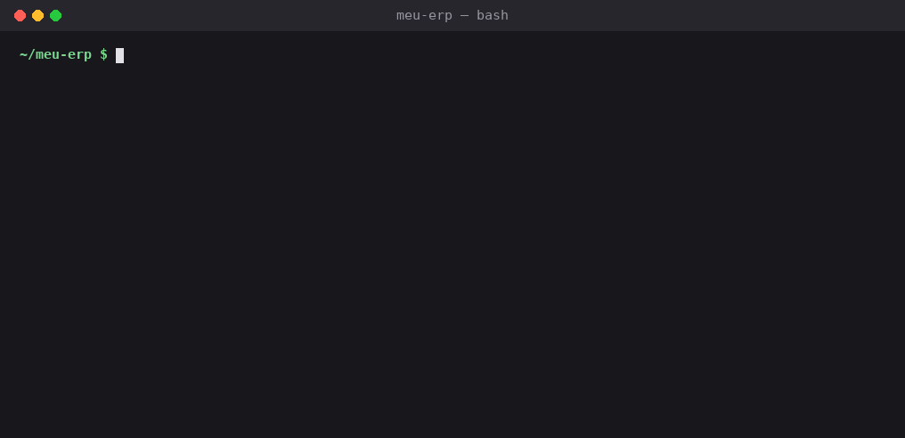

# cnpj-alfa-scan

[](https://github.com/AstralunaProject/cnpj-alfa-scan/actions/workflows/ci.yml)
[](https://www.npmjs.com/package/cnpj-alfa-scan)
[](LICENSE)

**Encontra no seu código o que vai quebrar com o CNPJ alfanumérico.**

Desde julho de 2026 a Receita Federal emite CNPJs com letras (IN RFB nº 2.229/2024; [resumo do Serpro](https://serpro.gov.br/menu/noticias/noticias-2024/cnpj-alfanumerico)), como `12.ABC.345/01DE-35`. Os CNPJs antigos continuam válidos, mas qualquer sistema que trate o CNPJ como número quebra no primeiro cliente novo: coluna `BIGINT`, `parseInt(cnpj)`, `/^\d{14}$/`, `replace(/\D/g, "")`, `<input type="number">`, máscara `99.999.999/9999-99`…

O `cnpj-alfa-scan` varre o repositório e aponta cada um desses pontos, com o arquivo, a linha e a correção.



**[Teste no navegador →](https://astralunaproject.github.io/cnpj-alfa-scan/)** Cole um trecho de código e veja o resultado; nada sai do seu computador.

## Uso

Requer Node.js 20 ou mais recente. Não tem dependências.

```bash
npx cnpj-alfa-scan .
```

```bash
npx cnpj-alfa-scan src db/migrations --ignore "test/**" --format sarif --output cnpj.sarif
```

| Opção | Descrição |
| --- | --- |
| `-f, --format <texto\|json\|sarif>` | Formato da saída. Padrão: `texto`. |
| `-o, --output <arquivo>` | Grava o relatório em arquivo. |
| `--fail-on <error\|warning\|none>` | Severidade mínima que faz o comando sair com código 1. Padrão: `error`. |
| `--ignore <glob>` | Ignora arquivos. Pode repetir. |
| `--rules` | Lista as regras. |

Códigos de saída: `0` sem problemas, `1` problemas encontrados, `2` uso inválido.

Em repositórios git, o `.gitignore` é respeitado. `node_modules`, `vendor`, `dist`, `build`, arquivos minificados, binários e arquivos acima de 1 MB são ignorados sempre.

### Ignorar um achado

```sql
cnpj_legado BIGINT, -- cnpj-alfa-scan-ignore
```

```js
// cnpj-alfa-scan-ignore-next-line
const id = parseInt(cnpjAntigo, 10);
```

## GitHub Action

Anota cada problema direto no diff do pull request e escreve um resumo no job.

```yaml
name: CNPJ alfanumérico
on: [pull_request]

jobs:
  cnpj:
    runs-on: ubuntu-latest
    steps:
      - uses: actions/checkout@v5
      - uses: AstralunaProject/cnpj-alfa-scan@v0.1.0
        with:
          ignore: |
            test/**
            fixtures/**
```

Para ver os achados na aba **Security → Code scanning**, grave um SARIF e envie:

```yaml
      - uses: AstralunaProject/cnpj-alfa-scan@v0.1.0
        with:
          sarif: cnpj.sarif
          fail-on: none
      - uses: github/codeql-action/upload-sarif@v3
        with:
          sarif_file: cnpj.sarif
```

| Entrada | Padrão | Descrição |
| --- | --- | --- |
| `path` | `.` | Caminhos a analisar. |
| `fail-on` | `error` | `error`, `warning` ou `none`. |
| `ignore` | | Globs a ignorar, um por linha. |
| `sarif` | | Caminho para gravar o SARIF. |

Saídas: `errors`, `warnings` e `sarif-file`.

## Semgrep

Já usa Semgrep? As mesmas regras estão em [`rules/semgrep.yml`](rules/semgrep.yml):

```bash
semgrep --config https://raw.githubusercontent.com/AstralunaProject/cnpj-alfa-scan/main/rules/semgrep.yml .
```

A CLI é um pouco mais precisa em campos de formulário que ocupam várias linhas: ela procura "cnpj" nas linhas vizinhas, e o Semgrep exige a palavra na mesma linha.

## Regras

| Regra | Severidade | O que encontra | Como corrigir |
| --- | --- | --- | --- |
| <a id="ca001"></a>CA001 | erro | Regex com `\d{14}` ou `[0-9]{12}` perto de um CNPJ | `/^[A-Z0-9]{12}\d{2}$/` |
| <a id="ca002"></a>CA002 | erro | Regex do formato `00.000.000/0000-00` só com dígitos | Troque `\d` por `[A-Z0-9]` nos 4 primeiros grupos |
| <a id="ca003"></a>CA003 | erro | `parseInt`, `int()`, `Long.parseLong`, `CAST(... AS BIGINT)`, `Character.getNumericValue`… sobre o CNPJ | Mantenha o CNPJ como texto |
| <a id="ca004"></a>CA004 | erro | `replace(/\D/g, "")`, `[^0-9]`, `somente_numeros(cnpj)` | Remova só `.`, `/` e `-` |
| <a id="ca005"></a>CA005 | erro | `isdigit()`, `ctype_digit`, `is_numeric`, `isNaN`, `^\d+$` | Valide formato e dígito verificador |
| <a id="ca006"></a>CA006 | erro | CNPJ como `BIGINT`, `NUMERIC`, `number`, `Long`, `BigIntegerField`, `$table->bigInteger`, `z.number()`… | `CHAR(14)` / `VARCHAR(14)` / string |
| <a id="ca007"></a>CA007 | erro | `<input type="number">` em campo de CNPJ | `type="text"` |
| <a id="ca008"></a>CA008 | aviso | `inputmode="numeric"`, `type="tel"`, `keyboardType="numeric"`, `pattern="[0-9]*"` | Teclado de texto, `autocapitalize="characters"` |
| <a id="ca009"></a>CA009 | erro | Máscaras `99.999.999/9999-99`, `00.000.000/0000-00`, `##.###.###/####-##` | Máscara alfanumérica nos 12 primeiros caracteres |
| <a id="ca010"></a>CA010 | aviso | `zfill(14)`, `padStart(14, "0")`, `%014d` | Trafegue o CNPJ como texto de 14 caracteres |

Veja exemplos de código afetado em [`examples/legado`](examples/legado) e a versão corrigida em [`examples/legado/correto.ts`](examples/legado/correto.ts).

## Validação do CNPJ alfanumérico

O pacote também traz um validador de referência, sem dependências:

```js
import { validarCnpj, formatarCnpj } from "cnpj-alfa-scan/cnpj";

validarCnpj("12.ABC.345/01DE-35"); // true
validarCnpj("11.222.333/0001-81"); // true, numérico continua válido
formatarCnpj("12abc34501de35");    // "12.ABC.345/01DE-35"
```

O cálculo é o mesmo do CNPJ numérico (módulo 11, pesos 2 a 9), com cada caractere valendo seu código ASCII menos 48: `0`–`9` valem 0–9 e `A`–`Z` valem 17–42. Os dois dígitos verificadores continuam numéricos.

## Perguntas frequentes

### O que é o CNPJ alfanumérico?

É o novo formato do CNPJ, emitido pela Receita Federal desde julho de 2026 (IN RFB nº 2.229/2024). Continua com 14 caracteres, mas os 12 primeiros podem ter letras maiúsculas e números, como `12.ABC.345/01DE-35`. Os dois dígitos verificadores continuam numéricos. Os CNPJs já existentes não mudam.

### Qual a regex para validar o CNPJ alfanumérico?

Sem máscara: `/^[A-Z0-9]{12}\d{2}$/`. Com máscara opcional: `/^[A-Z0-9]{2}\.?[A-Z0-9]{3}\.?[A-Z0-9]{3}\/?[A-Z0-9]{4}-?\d{2}$/`. A regex só confere o formato; para o dígito verificador, use `validarCnpj` (abaixo).

### Como validar CNPJ alfanumérico em JavaScript ou TypeScript?

```js
import { validarCnpj } from "cnpj-alfa-scan/cnpj";
validarCnpj("12.ABC.345/01DE-35"); // true
```

### Como meu banco de dados deve guardar o CNPJ?

Como texto: `CHAR(14)` sem máscara ou `VARCHAR(18)` com máscara. Colunas `BIGINT`, `NUMERIC` ou `INTEGER` não comportam letras; o scanner aponta essas colunas nas migrações e no DDL.

## Limitações

- A análise é por padrões de texto, linha a linha, não por árvore sintática. Pode haver falsos positivos (use `cnpj-alfa-scan-ignore`) e casos que escapam, principalmente quando a variável não se chama `cnpj`.
- Não analisa o banco em si: aponta a coluna nas migrações e no DDL versionados no repositório.

Encontrou um caso que deveria ser detectado, ou um falso positivo? [Abra uma issue](https://github.com/AstralunaProject/cnpj-alfa-scan/issues/new/choose) com o trecho de código. Para mexer nas regras, veja o [CONTRIBUTING](CONTRIBUTING.md).

## Desenvolvimento

```bash
npm install
npm run check   # typecheck, testes, regras Semgrep e varredura do próprio repositório
npm run site    # gera o playground em _site/
```

As regras ficam em [`src/rules.js`](src/rules.js). Ao alterar uma regra, inclua casos que ela detecta e casos que ignora em [`test/regras.test.js`](test/regras.test.js), e rode `npm run semgrep` para regenerar `rules/semgrep.yml`.

## In English

**cnpj-alfa-scan** finds code that will break with Brazil's new alphanumeric CNPJ (company tax ID), issued since July 2026: numeric DB columns, `parseInt`, `\d{14}` regexes, digit-only masks and number inputs. CLI, GitHub Action, Semgrep rules and a reference validator. Run `npx cnpj-alfa-scan .` or try the [browser playground](https://astralunaproject.github.io/cnpj-alfa-scan/).

## Licença

[MIT](LICENSE)
